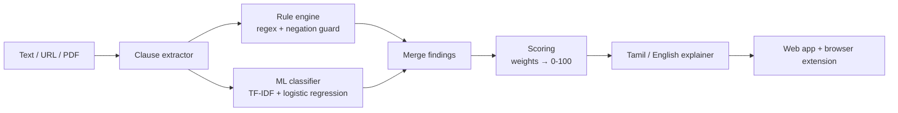

<div align="center">

# 📜 PadiPaar

### படி · பார் · பிறகு கையெழுத்திடு
**Read it. See it. Then sign.**

A Tamil-first tool that reads the terms you never read, finds the clauses that can hurt you,
and explains them in plain language, right next to the original text.

[](https://padipaar.onrender.com)


**[Try the live app](https://padipaar.onrender.com)** · **[How it works](#how-it-works)** · **[Run it yourself](#run-it-on-your-computer)** · **[Be honest about the limits](#what-it-cant-do-yet)**

</div>

---

## Why I built this

Think about the last time you tapped **"I Agree"**. Did you read the page above that button?

Almost nobody does. Terms and conditions run for dozens of pages, they are written in legal English, and they are
designed to be skipped. Hidden inside can be a subscription that renews by itself, a clause that lets a company
share your contacts with advertisers, or a line that quietly takes away your right to go to court.

For many people in Tamil Nadu, such as students signing up for a loan app, shop owners taking digital credit, and
parents using UPI and insurance apps, the problem is even harder: the document is in a language they find difficult,
and they have no one to ask.

PadiPaar is my attempt to fix that one small moment, the second before you sign.

## What it does

Paste a terms page, enter a web address, or upload a PDF. In a few seconds PadiPaar:

1. **Reads** the document and splits it into individual clauses.
2. **Flags** the risky ones across eight categories (listed below).
3. **Scores** the whole document from 0 to 100.
4. **Explains** every warning in simple Tamil (or English), with a practical tip, and shows the **original clause with
   the risky words highlighted**, so you can check it yourself instead of just trusting the tool.

A companion **browser extension** goes one step further. It also inspects the sign-up page itself for design tricks:
boxes that are already ticked, countdown pressure ("Only 2 left!"), and a tiny, hard-to-see "No thanks" button.

### What a result looks like

Run on the built-in demo document (invented text, not a real company):

| | |
|---|---|
| **Risk score** | **95 / 100, High** |
| **Clauses read** | 14, of which 13 were flagged |
| **Categories hit** | hidden fees · giving up court rights · data sharing · one-sided changes · no liability · too many permissions · penalties · auto-renewal |

Each finding comes with a short explanation, a tip on what to do, and the exact sentence it came from.

### The eight things it looks for

| Category | In plain words |
|---|---|
| 🔁 **Auto-renewal** | It charges you again and again until you cancel |
| 💸 **Extra or changing fees** | Costs that are not shown clearly up front |
| 🔗 **Data sharing** | Your information goes to partners or advertisers |
| 📱 **Too many permissions** | Contacts, SMS, location, camera, and more than the service needs |
| 🛡️ **No responsibility** | "We are not liable" for harm or loss |
| ⚖️ **Giving up court rights** | Forced arbitration, no class action |
| ✏️ **One-sided changes** | They can change the deal, or close your account, without asking |
| 🚫 **Penalty / no refund** | Cancelling costs you money |

---

## How it works



**Two detectors are better than one.** The rule engine is fast and fully explainable. It catches the obvious wording
and shows exactly which words triggered it. The machine-learning model catches the same idea written differently,
for example *"your plan renews monthly and we bill your wallet"* even though the word "automatically" never appears.
When both agree, confidence goes up.

**It tries not to cry wolf.** A sentence like *"We do not sell your personal data"* contains the words "sell" and
"personal data", but it is good news. A small negation guard stops it from being flagged.

**The score is simple on purpose.** Each category has a weight (data sharing counts most, 20 of 100). The tool takes
the highest confidence per category, so a long document does not look dangerous just because it repeats itself.
Bands: **Low 0 to 20, Medium 21 to 50, High 51 to 100.**

---

## Try it

**Web app:** open **[padipaar.onrender.com](https://padipaar.onrender.com)** and press one of the sample buttons.

> ⏳ It runs on a free server that goes to sleep when idle. If the first load is slow, give it about a minute.

**Browser extension (Chrome, Edge, Brave):**

1. Open `edge://extensions` (or `chrome://extensions`) and turn on **Developer mode**.
2. Click **Load unpacked** and choose the `padipaar/extension` folder.
3. Pin the green **P**, open **Settings**, and paste your server address. Use the live one above, or
   `http://127.0.0.1:5000` if you run it locally.
4. Open any terms or sign-up page and press **Scan this page**.

---

## Run it on your computer

You need Python 3.11 or newer.

```bash
git clone https://github.com/<your-username>/padipaar-project.git
cd padipaar-project/padipaar

python -m venv venv
# Windows:   venv\Scripts\activate
# Mac/Linux: source venv/bin/activate

pip install -r requirements.txt
python -m app.train        # trains the model, takes a few seconds
python wsgi.py             # then open http://127.0.0.1:5000
```

Run the test suite:

```bash
python -m unittest discover -s tests -v
```

## Deploy your own copy (free)

The backend also serves the web app, so there is **one service and no separate frontend build**.

On [Render](https://render.com): New → Web Service → pick this repo, then set

| Setting | Value |
|---|---|
| Root Directory | `padipaar` |
| Build Command | `pip install -r requirements.txt && python -m app.train` |
| Start Command | `gunicorn wsgi:app --bind 0.0.0.0:$PORT --workers 1 --threads 4 --timeout 60` |
| Health Check Path | `/health` |
| Env var | `PYTHON_VERSION` = `3.12.3` |

A `Dockerfile` and `Procfile` are included for other hosts.

---

## Under the hood

```
padipaar/
├── app/
│   ├── main.py             Flask API + web app server, rate limiting, security headers
│   ├── extractor.py        text / URL / PDF → clauses (with SSRF protection)
│   ├── rules.py            regex rule engine + negation guard
│   ├── train.py            trains the classifier
│   ├── classifier.py       hybrid detector: rules + ML
│   ├── scoring.py          weights → 0-100 and Low / Medium / High
│   ├── explainer.py        attaches Tamil + English explanations
│   ├── explanations_ta.json   every Tamil / English sentence lives here
│   └── db.py               SQLite score board (stores no user documents)
├── static/                 the web app (plain HTML, CSS, JavaScript)
├── extension/              browser extension (Manifest V3)
├── tests/                  25 automated tests
└── scripts/                helper to add real apps to the Compare page
```

**Stack:** Python · Flask · scikit-learn · BeautifulSoup · pdfplumber · SQLite · vanilla JavaScript · Manifest V3

### API

| Method | Endpoint | Purpose |
|---|---|---|
| `POST` | `/api/analyze` | `{"text": "..."}` or `{"url": "https://..."}` |
| `POST` | `/api/analyze/pdf` | upload a PDF (max 8 MB) |
| `GET` | `/api/scores` | the public Compare board |
| `GET` | `/api/model-info` | categories and validation numbers |
| `GET` | `/health` | status check |

### Safety and privacy, built in

- Documents are analysed **in memory and never stored**. Only the demo score board is saved.
- URL fetching blocks private and local addresses, limits redirects and download size (SSRF protection).
- Input size limits, per-visitor rate limiting, security headers and a content-security policy.

---

## What it can't do yet

I would rather tell you than let you find out.

- **The training data is small.** The model learned from about 180 hand-written clauses. Its cross-validation score
  (macro-F1 ≈ 0.69) comes from that same small set, so treat it as optimistic, not as proof of real-world accuracy.
  The next step is labelling real clauses from real terms pages and testing on a separate set.
- **It reads English terms.** The explanations are Tamil and English, but the documents it analyses must be in English.
- **Some websites can't be fetched by address.** Pages that need JavaScript or block bots will ask you to paste the
  text instead. PDFs that are scans (images) can't be read either.
- **It is a highlighter, not a lawyer.** A high score means "read this carefully", not "this company is acting
  illegally". Nothing here is legal advice.
- **The Tamil was written by me, not a professional translator.** Corrections are very welcome.

## Roadmap

- [ ] A larger, properly labelled dataset and an honest held-out test set
- [ ] Tamil-language terms as *input*, not only output
- [ ] More languages through the same JSON explanation files (Hindi, Telugu, Malayalam)
- [ ] OCR for scanned PDFs
- [ ] A real Compare board of popular Indian apps, with dates and sources
- [ ] Publish the extension to the Chrome and Edge stores

## Contributing

Spotted a wrong or awkward Tamil sentence? Found a clause it misses or flags by mistake? Open an issue and paste
the sentence. Every explanation lives in [`app/explanations_ta.json`](padipaar/app/explanations_ta.json), so fixing the
wording does not need any code.

---

<div align="center">

**Built by LANZHAN** · Department of Artificial Intelligence and Data Science,
Er. Perumal Manimekalai College of Engineering

*Submitted to IGNITE 2026, Open Innovation Challenge*

*PadiPaar highlights possible risks using automated analysis. It is not legal advice.*

</div>
